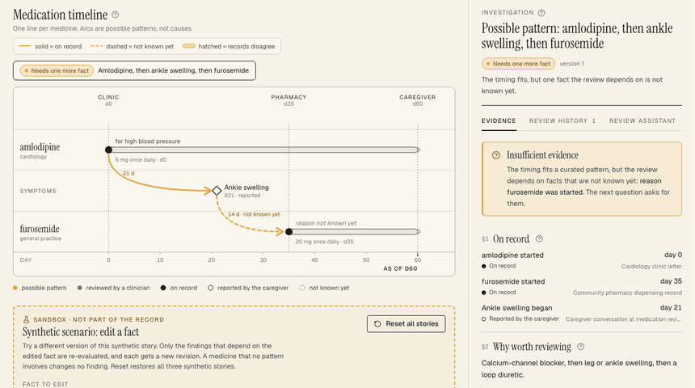
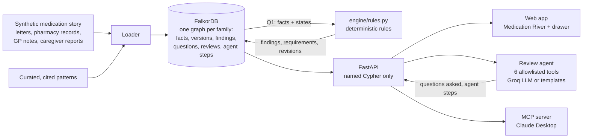
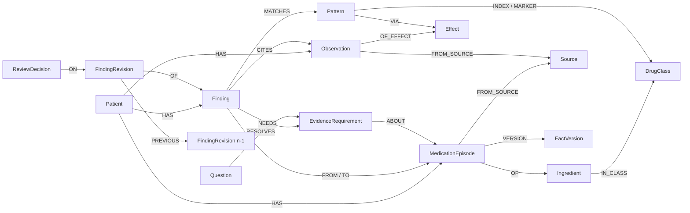

# FirstDomino

**Sometimes a side effect of one medicine is mistaken for a new illness and treated with another
medicine. FirstDomino finds these possible chains in a medication story and asks for the one missing
fact a clinician needs.**



- **Web app:** https://firstdomino-web.vercel.app
- **API health:** https://api-production-b29f.up.railway.app/health
- **Video:** <link>

Built for **Graph Hacks** (WeMakeDevs x FalkorDB, 15-18 Oct 2026) by team **Kodeline**.

> [!IMPORTANT]
> **All patient data in this repository is synthetic.** FirstDomino is a hackathon prototype, not a
> medical device, and it has not been clinically validated. Findings are *possible patterns for a
> clinician to review*, never conclusions about causes, and never advice to change a medicine.

## The problem

An older person starts amlodipine for blood pressure. A few weeks later their ankles swell, a known
side effect. At a different visit, with a different doctor, the swelling is treated with furosemide, a
water tablet. Now there are two medicines, and the second one exists because of the first. This is a
**prescribing cascade**. Each step looks reasonable on its own. The pattern only shows when someone
lines up the whole story across visits, letters, pharmacy records and what the family remembers, and
that story is rarely in one place.

The problem is well described:

- **ThinkCascades (2022).** An international expert panel agreed on nine clinically important
  prescribing cascades that affect older people.
  McCarthy LM, Savage R, Dalton K, et al. *Drugs Aging* 2022;39(10):829-840.
  [doi:10.1007/s40266-022-00964-9](https://doi.org/10.1007/s40266-022-00964-9)
- **PIPC list (2025).** A 12-member international panel agreed on 65 *potentially inappropriate*
  prescribing cascades, from 107 proposed, to help clinicians spot them during medication review.
  Rochon PA, O'Mahony D, Cherubini A, et al. *Eur Geriatr Med* 2025;16(5):1573-1584.
  [doi:10.1007/s41999-025-01215-x](https://doi.org/10.1007/s41999-025-01215-x)
- **BMJ (2026).** Among about 2.3 million community-dwelling adults aged 66 or older in Ontario, 24 of
  those 65 cascades stood out as high priority: common, frequent and closely timed.
  Rochon PA, Austin PC, Gurwitz JH, et al. *BMJ* 2026;394:e100499.
  [doi:10.1136/bmj-2026-100499](https://doi.org/10.1136/bmj-2026-100499)
- **India (Scientific Reports 2025).** In 600 older adults across six Indian cities, 33.7% had
  polypharmacy, 19.7% self-medicated, and 28.8% were prescribed at least one potentially
  inappropriate medicine. This is the setting where cascades are hard to see. The study measures
  polypharmacy and inappropriate prescribing, not cascades themselves.
  Das S, Gnanavel P, Smanla S, et al. *Sci Rep* 2025;15:4062.
  [doi:10.1038/s41598-024-84627-2](https://doi.org/10.1038/s41598-024-84627-2)

## What FirstDomino does, and what it does not

| It does | It does not |
|---|---|
| Rebuild a patient's medication story across visits as a graph: medicines, observations, sources, each with when it happened, when it was recorded, and how sure the record is | Use real patient data. All three stories are synthetic |
| Match the story against a small set of curated, cited patterns (one so far: calcium-channel blocker → ankle swelling → loop diuretic) | Say that one medicine *caused* another, or that a prescription was wrong. Findings are **possible patterns**, never causes |
| Name the one missing fact a clinician needs, and who could supply it (the caregiver, the prescriber) | Tell anyone to change a medicine. That is the prescribing clinician's decision |
| Keep every fact, finding, question and review with its history, so a late correction reopens only what depends on it | Claim clinical accuracy. It has not been clinically validated. The proof suite below checks the engine against its own documented rules, nothing more |

**Who it's for:** the **pharmacist** runs the medication review, the **caregiver** supplies facts
("when did the swelling start?"), and the **clinician** decides. Each decision is recorded against the
exact revision it was made on.

Finding statuses: `candidate` · `needs_evidence` · `competing_explanation` · `needs_reassessment` ·
`reviewed` · `not_matched`. None of them means "caused".

## Try it in 2 minutes

Open **https://firstdomino-web.vercel.app** and click **Take the 2-minute guided tour**. The ten
steps cover two stories:

1. **Story 1, the missing reason.** Amlodipine, then ankle swelling, then furosemide, but nobody wrote
   down why furosemide was started. The amber arc on the Medication River marks the possible pattern.
   The drawer shows what is documented, what the caregiver reported, and what is not known yet. Answer
   the one missing fact and watch the finding change.
2. **Story 3, when the record changes.** A clinician already reviewed the finding. A late GP note moves
   the swelling onset from day 28 to day 14. FirstDomino creates revision 2, `needs_reassessment`, and
   keeps the clinician's decision on revision 1. Changing atorvastatin, which is in no pattern, reopens
   nothing.

The tour resets the story it uses, so every visitor starts from the same synthetic record. You can
restart it from the **Guided tour** button in any page header.

| Patient | Story | Finding |
|---|---|---|
| `syn-p1` | Nobody recorded why furosemide was started | `needs_evidence`: asks the caregiver for the reason |
| `syn-p2` | A discharge summary documents a different reason (new heart failure) | `competing_explanation`: shown side by side, not dismissed, and the prescriber is never called mistaken |
| `syn-p3` | A clinician reviewed revision 1; a GP note then moves the swelling onset | Revision 2 `needs_reassessment`, the decision stays on revision 1 |

## Build your own patient: the patient lab

Three stories can look staged, so **https://firstdomino-web.vercel.app/lab** lets you build one.

1. Place up to five medicines on a timeline (amlodipine, nifedipine, felodipine, diltiazem, furosemide,
   bumetanide, torsemide, hydrochlorothiazide, atorvastatin, metformin, lisinopril), set each start day
   and how sure it is (on record, the caregiver says, not known), give a reason or leave it unrecorded,
   and add ankle swelling or not.
2. **Write to the graph and walk it.** `POST /lab/patients` writes a new synthetic patient into FalkorDB
   with the same named write queries as the stories, and Q1 plus the unchanged `engine/rules.py` evaluate
   it. The page shows each step's time on the live graph, then draws each finding's walk edge by edge:
   patient → medicine → ATC class ← pattern → effect ← symptom, and pattern → second class ← second
   medicine.
3. **The same list, read without the graph.** Next to the result, the page shows what a flat check would
   say ("a calcium-channel blocker and a diuretic, together"). Put furosemide first and the flat check
   still flags the pair; the graph says the order doesn't fit. Swap amlodipine for diltiazem, which is
   also called a calcium-channel blocker but sits in another ATC class (`C08DB`, not `C08CA`), and the
   flat check flags it while the graph finds no chain.
4. **Open the full review.** The new `lab-…` patient works everywhere: answer the missing fact, run the
   review agent, ask Q3 what depends on a fact, print the packet.

**Without FalkorDB there is no answer.** With `FD_STORE=fixtures` the lab endpoint returns
`503 {"error": "graph_required"}`, and the web app's fixture mode says the same. There is no fallback:
a patient nobody has seen can only be evaluated as a graph traversal. The newest 40 lab patients are
kept, and **Reset all stories** deletes them all.

## Architecture and graph model



- **FalkorDB holds everything.** One graph per family (`family_<id>`), and every traversal starts from
  `Patient {id: $pid}`. The knowledge layer (patterns, ingredients, ATC classes, effects) is copied
  into each family graph from `kb_template`.
- **Facts carry their certainty.** Each fact is `documented`, `reported` (by the caregiver),
  `conflicting` or `unknown`, and has both `happened_at` and `recorded_at` as day numbers. An answer of
  `not_available` is never read as "no".
- **Deterministic code decides findings.** Named Cypher queries gather the facts, and tested Python
  rules set the status. The language model never creates or changes a finding.
- **Nothing is overwritten.** A fact change appends a `FactVersion`. Only the findings that depend on
  the changed fact (Q3) are evaluated again, and each gets a new `FindingRevision`. A stale write gets
  HTTP 409. Re-sending the same evidence event is harmless, and an interrupted one resumes.



From [docs/data-model.md](docs/data-model.md):

| Layer | Label | Properties |
|---|---|---|
| Knowledge | `Ingredient` | `name`, `rxcui` |
| | `DrugClass` | `code` (ATC, e.g. `C08CA`, `C03CA`) |
| | `Effect` | `name` (e.g. `peripheral_edema`) |
| | `Pattern` | `id`, `version`, `title`, `window_days`, `requires`, `evidence_refs` (JSON string: FalkorDB has no map properties) |
| Patient facts | `Patient` | `id`, `label`, `age_band`, `case_version`, `as_of_day`, `synthetic` |
| | `Prescriber` | `id` (`<pid>:prs-<specialty>`, patient-scoped so no node is shared), `specialty` |
| | `Source` | `id`, `kind`, `label`, `happened_at`, `recorded_at` |
| | `MedicationEpisode` | `id`, `happened_at`, `recorded_at`, `state`, `dose_text`, `indication`, `indication_state`, `stop_day` |
| | `Observation` | `id`, `happened_at`, `recorded_at`, `state`, `label` |
| Reasoning | `Finding` | `id`, `patient_id`, `status`, `revision_n`, `pattern_version`, `eval_version`, `headline` |
| | `EvidenceRequirement` | `id`, `patient_id`, `finding_id`, `kind` (`start_day`/`onset_day`/`indication`/`order`), `field`, `state` (`missing`/`provided`/`not_available`) |
| Investigation + memory | `Question` | `id`, `patient_id`, `requirement_id`, `ask_role`, `text`, `asked_at`, `answer`, `answer_state` (written by `POST /questions`) |
| | `FindingRevision` | `id`, `n`, `status`, `reason`, `changed_fact_ids`, `created_at`, `eval_version` |
| | `ReviewDecision` | `id`, `patient_id`, `finding_id`, `revision_n`, `by_role`, `decision`, `reason`, `decided_at` |
| | `FactVersion` | `id` (`<fact id>:ver-<n>`), `fact_id`, `n`, the fact's stored properties and `source_ids` at that version, `superseded_at`, `event_id` |
| | `EvidenceEvent` | `id` (the request's `event_id`), `patient_id`, `status` (`pending`/`applying`/`applied`), `case_version`, `change`, `before`, `after`, `findings_before` and `result` (JSON strings), `recorded_at` |
| | `AgentStep` | `id`, `patient_id`, `tool`, `ok`, `args_json` (FalkorDB stores no maps), `result_ids`, `at`, `seq` |

The full relationship table, the rules and how evidence changes are applied are in
[docs/data-model.md](docs/data-model.md). The API, with JSON examples, is in [docs/api.md](docs/api.md).

## Every Cypher query

Every query is a named, parameterised file in [`engine/queries/`](engine/queries), loaded with
`engine.cypher.load(name)`. None is inlined or built with string formatting. Every patient query
starts from `Patient {id: $pid}`, and `tests/test_contracts.py` enforces that.

**Reads (`q*`)**

| Query | What it answers |
|---|---|
| `q1_candidate_match` | Which index episode, observation and marker episode could form a pattern for this patient, with every fact's day and state (the rules decide the status) |
| `q2_next_question` | Which missing fact the most open findings depend on: the next thing to ask |
| `q3_affected` | Which findings cite, link or need this fact, so would re-evaluate if it changed (no others do) |
| `q4_evidence_pack` | For one finding: every linked fact, its sources and open requirements (the drawer) |
| `q5_history` | For one finding: every revision, the one it follows, the decisions kept on their revision, and the events behind each |
| `q6_patient_findings` | This patient's findings, with the IDs each links to |
| `q7_timeline` | The current version of every fact, the sources, and evidence received but not confirmed yet |
| `q8_evidence_event` | One evidence event, so re-sending its `event_id` replays it or resumes it |
| `q9_requirements` | This patient's requirements, what each is about, and the question asked for it |
| `q10_agent_steps` | The review agent's steps for this patient, oldest first |

**Writes (`write/`)**: each is a `MERGE` or a compare-and-set in one query.

| Query | What it writes |
|---|---|
| `patient`, `source`, `episode`, `observation`, `fact_sources`, `prescriber` | The story's facts and where each came from (null properties are removed, so an unknown day stays unknown) |
| `kb_ingredient`, `kb_effect`, `kb_pattern` | The knowledge layer: ingredients and ATC classes, effects, curated cited patterns |
| `finding`, `finding_cites`, `revision` | A finding from the rules, what it cites, and revision 1 (`ON CREATE` only, so reloading never rewrites history) |
| `requirement`, `requirement_sync`, `requirement_provided`, `requirement_not_available` | One requirement per gap; a closed gap becomes `provided`; a `not_available` answer stays `not_available` and is never read as "no" |
| `evidence_apply` | A confirmed fact change: compare-and-set on `case_version`, then a new `FactVersion` |
| `evidence_done`, `evidence_pending` | Mark an evidence event applied with its result; seed evidence that is not confirmed yet |
| `revision_next` | Revision n+1 after a change, linked by `PREVIOUS` and `BECAUSE`, with decisions left on their revision |
| `review` | A review decision on the current revision: compare-and-set on `case_version` and `revision_n` |
| `seed_decision` | A decision that is already part of a story (story 3) |
| `question` | That the question for an open requirement was asked (never its answer) |
| `agent_step` | One review-agent step as an audit record |

**Admin (`admin/`)**

| Query | What it answers |
|---|---|
| `patients_in_graph` | Which patients live in this family graph (routes a patient to its graph) |
| `requirement_states` | Every requirement state for one patient (tests, the proof suite) |
| `fact_versions` | Every stored version of one fact, oldest first |
| `graph_counts` | Node and edge counts by label and type (idempotency checks) |
| `drop_patient` | Delete one patient's subgraph for a per-story reset; the shared knowledge stays |

## The review agent

One bounded pass over one finding (`POST /findings/{id}/review-agent`), using at most six steps and
six allowlisted tools ([`agent/tools.py`](agent/tools.py)):

| Tool | What it does |
|---|---|
| `get_evidence_pack` | Read the documented, conflicting and unknown facts for the finding (Q4) |
| `inspect_episode` | Read one medication episode: start day, reason, sources |
| `next_missing_fact` | Find the next fact the pattern still needs and who could supply it (Q2) |
| `ask_question` | Record that the question for an open requirement was asked (`POST /questions`); the agent may phrase it |
| `request_reevaluation` | Read which findings depend on a fact (read-only Q3); changes nothing |
| `prepare_packet` | Draft the next conversation to have with the clinician |

**Guards**

- **The LLM never creates findings.** Only `engine/rules.py` does. The agent cannot answer a question,
  write evidence, change a fact or record a decision.
- **Every reply is checked.** It must be valid JSON naming an allowed tool, and its args and cited IDs
  must come from earlier tool results. Its text may not invent day numbers, dates, medicines or
  reasons, may not use certainty words ("documented", "confirmed", "verified", "known"; certainty comes
  from each fact's state in the record), and must follow the copy rules.
- **Templates are the fallback.** A rejected reply or a 429/5xx/timeout gets one retry, then
  deterministic templates. The reason is recorded on the step (`args.fallback_reason`). Without an API
  key the whole pass runs on templates, so it always finishes.
- **Every step is persisted** as an `AgentStep` in FalkorDB, failures included, and the API limits
  LLM-backed passes per client.

The LLM is reached through Groq's OpenAI-compatible API (`openai/gpt-oss-120b` by default, with an
optional fallback model). See [AI_USAGE.md](AI_USAGE.md).

## Use FirstDomino from Claude Desktop

`mcp_server/` is an MCP server (Python MCP SDK, FastMCP, stdio). An AI client such as Claude Desktop can
use FirstDomino's tools through it. Every tool calls the FirstDomino HTTP API, never the graph directly.
By default that is the live API (`https://api-production-b29f.up.railway.app`), so no local backend is
needed. Set `FD_API_URL` to use another one, for example `http://localhost:8000`.

| Tool | What it returns |
|---|---|
| `list_stories` | The synthetic stories, their findings and statuses |
| `get_evidence_pack(finding_id)` | What is on record, what conflicts, what is not known yet, the cited pattern, the sources |
| `next_missing_fact(patient_id)` | The next question to ask, who to ask, and the fact it fills |
| `inspect_episode(episode_id)` | One medication episode and the findings that use it |
| `which_findings_depend_on(patient_id, fact_id)` | The findings evaluated again if that fact changes (read-only) |
| `prepare_packet(patient_id)` | The clinician's review packet as text |

Each result is plain text that ends with the evidence IDs it rests on. These tools are read-only. Two
write tools, `ask_question` and `run_review_agent`, are added only when `FD_MCP_ALLOW_WRITES=1`, and
they act on the synthetic stories only.

You need [uv](https://docs.astral.sh/uv/) and a clone of this repo. Then add this entry to
`%APPDATA%\Claude\claude_desktop_config.json` on Windows, with your repo path, and restart Claude Desktop:

```json
{
  "mcpServers": {
    "firstdomino": {
      "command": "uv",
      "args": ["run", "--directory", "C:\\Users\\you\\firstdomino", "python", "-m", "mcp_server"]
    }
  }
}
```

On macOS the file is `~/Library/Application Support/Claude/claude_desktop_config.json`, and the path
looks like `/Users/you/firstdomino`. If Claude Desktop cannot find `uv`, put its full path in
`command` (`where uv` on Windows, `which uv` on macOS). To allow the write tools, add
`"env": { "FD_MCP_ALLOW_WRITES": "1" }` next to `args`.

Demo prompt:

> Using FirstDomino, review story 1 and tell me the next question a pharmacist should ask, and which
> findings depend on that fact.

Tests: `uv run pytest tests/test_mcp.py` runs over a fake HTTP layer. `FD_MCP_LIVE=1 uv run pytest
tests/test_mcp_live.py` calls every read tool against the live API.

## Tracks entered

### Agents That Act on Connected Data

The review agent and the MCP server act on the graph, not on a text dump. They act only through
named queries behind the API, and each traversal starts from the patient. The agent follows edges to
find the missing fact (Q2), asks for it (`Question -[:RESOLVES]-> EvidenceRequirement`), and checks
which findings depend on a fact (Q3) before anything changes. When a human then confirms evidence,
only the findings connected to that fact are evaluated again.

### Agent Memory and Coordination

FalkorDB is the shared memory for three roles that never hold state of their own: the caregiver
(facts), the pharmacist and agent (questions, agent steps) and the clinician (decisions on a specific
revision). Every fact keeps its versions, every finding keeps its revisions, every decision stays on
the revision it was made on, and every agent step is an audit record. An evidence event is written as
`applying` together with the fact change. If the API stops in between, re-sending the same `event_id`
resumes the remaining steps instead of failing.

**Restart-persistence evidence**

- `make test-restart` (`tests/test_stack.py::test_restart_of_api_and_falkordb_keeps_everything`)
  confirms story 3's correction and a second review, restarts **both** the FalkorDB and API
  containers, and checks that the timeline, findings and investigation are identical afterwards.
  That covers `case_version` 6, revisions `[(1, candidate), (2, needs_reassessment)]` and decisions on
  revisions 1 and 2. It also checks that re-sending the same evidence event replays it
  (`replayed: true`). Last run 2026-10-18 on a fresh Docker Compose stack: `5 passed`.
- On Railway (2026-10-16, [docs/deploy.md](docs/deploy.md)): after a live review-agent pass, a
  restart of the API service gave identical reads (`syn-p1` v3 with 7 agent steps, `syn-p2` v2,
  `syn-p3` v4). FalkorDB runs with AOF on (`/health` reports `"appendonly": "yes"`).

## Proof

[bench/results.md](bench/results.md), numbers unedited:

> **12 of 12 cases agree with their documented expectation** (98 of 98 checks).

| Case | Covers | Checks agreed | Result |
|---|---|---|---|
| `case01` | positive match (candidate) | 7/7 | agrees |
| `case02` | unknown onset (needs_evidence) | 7/7 | agrees |
| `case03` | unknown indication (needs_evidence) | 7/7 | agrees |
| `case04` | documented different reason (competing_explanation) | 7/7 | agrees |
| `case05` | reported different reason (competing_explanation) | 7/7 | agrees |
| `case06` | reversed documented chronology (not_matched) | 7/7 | agrees |
| `case07` | reported reversed order (order requirement) | 7/7 | agrees |
| `case08` | conflicting dates (stays candidate, conflict listed) | 8/8 | agrees |
| `case09` | reviewed then corrected (needs_reassessment, decision kept) | 9/9 | agrees |
| `case10` | unrelated medicine change (no revision) | 8/8 | agrees |
| `case11` | not_available answer (never read as 'no') | 9/9 | agrees |
| `case12` | two patients in one family graph (no crossing) | 15/15 | agrees |

- **The runner was checked too.** Five expectations were made deliberately wrong (a status, a
  requirement kind, the findings a change re-evaluates, a requirement state, and the other patient's
  `case_version`), and all five were reported as disagreements.
- **What this is and is not.** The 12 synthetic cases (`data/cases/`) were written by the same team
  that built the engine, from the documented rules in `docs/data-model.md` and the story fixtures, not
  from `engine/rules.py`. Agreement shows the engine does what its own documentation says. **It is not
  clinical accuracy.** Writing the cases also exposed four under-documented behaviours, which are now
  written down in `docs/data-model.md`.
- Run it: `make bench` (FalkorDB on `localhost:6379`).

## Run locally

Requirements: Docker. For development: Python 3.11 with [uv](https://docs.astral.sh/uv/), and Node 20+.

```bash
docker compose up --build
```

| Service | URL |
|---|---|
| Web app | http://localhost:3001 |
| API (OpenAPI docs at `/docs`) | http://localhost:8000 |
| FalkorDB Browser (connect to `localhost:6379`) | http://localhost:3000 |

No `.env` is needed for the demo. Without `LLM_API_KEY` the review agent runs on its templates.

| Task | With `make` | Without `make` |
|---|---|---|
| Start everything | `make up` | `docker compose up -d --build` |
| Stop | `make down` | `docker compose down` |
| API with reload | `make dev-api` | `uv run uvicorn api.main:app --reload --port 8000` |
| Web with reload | `make dev-web` | `cd web && npm install && npm run dev` |
| Tests | `make test` | `uv run pytest` and `cd web && npm run typecheck` |
| Tests in the API container (graph mode) | `make test-stack` | `docker compose --profile test run --rm --build api-test` |
| Restart FalkorDB + API, check nothing is lost | `make test-restart` | `FD_API_URL=http://localhost:8000 FD_STACK_RESTART=1 uv run pytest tests/test_stack.py` |
| Lint | `make lint` | `uv run ruff check .` and `cd web && npm run lint` |
| Seed the graph | `make seed` / `make reseed` | `uv run python -m engine.loaders.seed [--reset]` |
| Regenerate web fixtures | `make snapshots` | `uv run python -m api.snapshots` |
| P2 proof suite (FalkorDB on `localhost:6379`) | `make bench` | `uv run python -m bench.run` |

The web app reads data through one adapter, `web/lib/api.ts`. `NEXT_PUBLIC_DATA_SOURCE=fixtures` (the
default for `npm run dev`) serves saved API responses from `data/snapshots/fixtures.json`, so the UI
works without a backend. `live` calls the API at `NEXT_PUBLIC_API_URL`, and Docker Compose uses this.
`uv run uvicorn …` without `FD_STORE=graph` serves in-memory fixtures; Docker Compose runs the API on
FalkorDB.

> [!NOTE]
> If `next build` fails with `<Html> should not be imported outside of pages/_document`, your shell
> has `NODE_ENV=development` set. Build with `NODE_ENV=production npm run build`
> (PowerShell: `$env:NODE_ENV="production"; npm run build`).

```
api/        FastAPI (Python 3.11, uv). models.py = contract types, graph_store.py = FalkorDB,
            store.py = fixture stub, main.py = routes
engine/     queries/*.cypher (named, parameterised), cypher.py, rules.py, evaluate.py, loaders/
agent/      the bounded review agent and its tool allowlist
mcp_server/ MCP server (stdio): read-only tools over the HTTP API, for Claude Desktop
web/        Next.js 15, TypeScript, Tailwind, shadcn/ui, framer-motion
data/       patterns/ (cited), stories/ (synthetic fixtures), snapshots/, cases/ (P2 proof cases)
bench/      P2 proof suite runner and results.md
docs/       data-model.md, api.md, deploy.md
tests/      API behaviour, contract guards, graph and golden tests, MCP
```

## Deployment

The API runs on Railway next to a FalkorDB service (AOF on), and the web app on Vercel. Merging to
`main` deploys both. Commands, variables (by name only) and the live checks are in
[docs/deploy.md](docs/deploy.md).

## Limitations

- **One pattern, three stories, plus the lab.** Lab patients use the same single pattern. The curated set has one pattern (calcium-channel blocker → ankle
  swelling → loop diuretic) and three synthetic stories. The graph and rules are built for more, but
  more patterns have not been curated yet.
- **Not clinically validated.** No real patient data, no clinical study, no regulatory review. The
  proof suite checks agreement with our own documented rules, written by the team that built the
  engine.
- **No timing window.** `window_days` (90) is shown with the pattern but excludes nothing, because
  the association can last up to a year.
- **No authentication.** The server checks only that the patient exists in the family graph. Real use
  would need access control per caller.
- **Synthetic-only writes on the public demo.** Anyone can reset the demo stories, and the tour does
  so when it starts.
- **LLM phrasing depends on a free tier.** On rate limits the agent falls back to templates. The
  outcome is the same, the wording is plainer.

## Data sources and licences

- **Patient stories and proof cases:** synthetic, written by the team for this project.
- **Pattern evidence:** cited, not copied. Savage RD et al., *JAMA Intern Med* 2020
  ([doi:10.1001/jamainternmed.2019.7087](https://doi.org/10.1001/jamainternmed.2019.7087)), and Vouri
  SM et al., *JAMA Netw Open* 2019
  ([doi:10.1001/jamanetworkopen.2019.18425](https://doi.org/10.1001/jamanetworkopen.2019.18425)).
  The background sources above are cited, not reproduced.
- **Codes:** drug classes use the WHO ATC classification (WHO Collaborating Centre for Drug Statistics
  Methodology). Ingredient identifiers are RxNorm RxCUIs (U.S. National Library of Medicine). Only the
  few codes the stories need are included.
- **Not used:** adverse-event report counts. FDA notes that these reports cannot establish causation.
- **Software:** FalkorDB, FastAPI, Next.js, the MCP Python SDK and the other dependencies in
  `pyproject.toml` and `web/package.json`, under their own licences.
- **This repository** does not carry a licence file yet.

## Guardrails

- Every Cypher query is a named, parameterised file, and every patient traversal starts from the patient.
- Every ID is scoped to its patient, and every date is a day number.
- Copy never says "safe", "stop taking", "cleared" or "caused by". A test scans the data, API, agent,
  MCP server and web code for those words.
- Patterns are curated and cited. Side effects extracted from drug labels are drafts for review, never
  automatic knowledge.

## Team

**Kodeline**

| Member | Area |
|---|---|
| Ajay Singh | Web app, review agent, MCP server |
| Dev Grover | Engine (queries, rules, loaders), API |

How we used AI while building this: [AI_USAGE.md](AI_USAGE.md).
